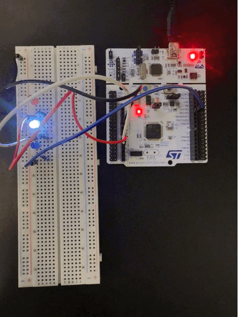

# FreeRTOS 3 LED Example

Runs FreeRTOS on my STM32 Nucleo Board and blinks 3 leds simulateneously to demonstrate the advantages of a real time operating system



## Overview

I wanted to get some hands on experience with scheduling in a real time operating system. I used my STM32 Nucleo-F401RE and some LEDs wired over GPIO pins to create a light for each task. I was able to play with setting different priorities, and using ```wait``` vs ```osDelay``` to manipulate the time and order that the LEDs flash.

## Features

- FreeRTOS using HAL CMSIS_V2
- Multitasking
- GPIO output

## Hardware

| Component | Purpose | Interface |
|-----------|---------|-----------|
| Red, White, BLue LEDs | Illuminate | GPIO |
| STM32 Nucleo F401-RE | Microcontroller | FreeRTOS |

## Software Architecture

Features 4 tasks with different priority levels, and optionally blocks the cpu or uses freertos to allow other tasks to run

| Task / Module | Priority | Responsibility |
|---------------|----------|----------------|
| Task1 | High | Toggles red LED every 1 second|
| Task2 | Normal | Toggles white LED every 0.5 seconds |
| Task3 | Low | Toggles blue LED every 0.2 seconds |
| Task4 | Very High | Inactive, used to test preemption |

## Getting Started

### Prerequisites

- Cmake, GCC
- STM32 Nucleo F401-RE

### Assembly

Connect PA0 to red LED positive, PA1 to white LED, and PA4 to blue LED

### Build and Flash

```bash
git clone https://github.com/mason-fernandez/FreeRTOS_3LEDs
cd FreeROTS_3LEDs
make
make flash
```

## License

MIT

## Contact

Mason Fernandez · [LinkedIn](https://linkedin.com/in/mason-fernandez) · [GitHub](https://github.com/mason-fernandez)
